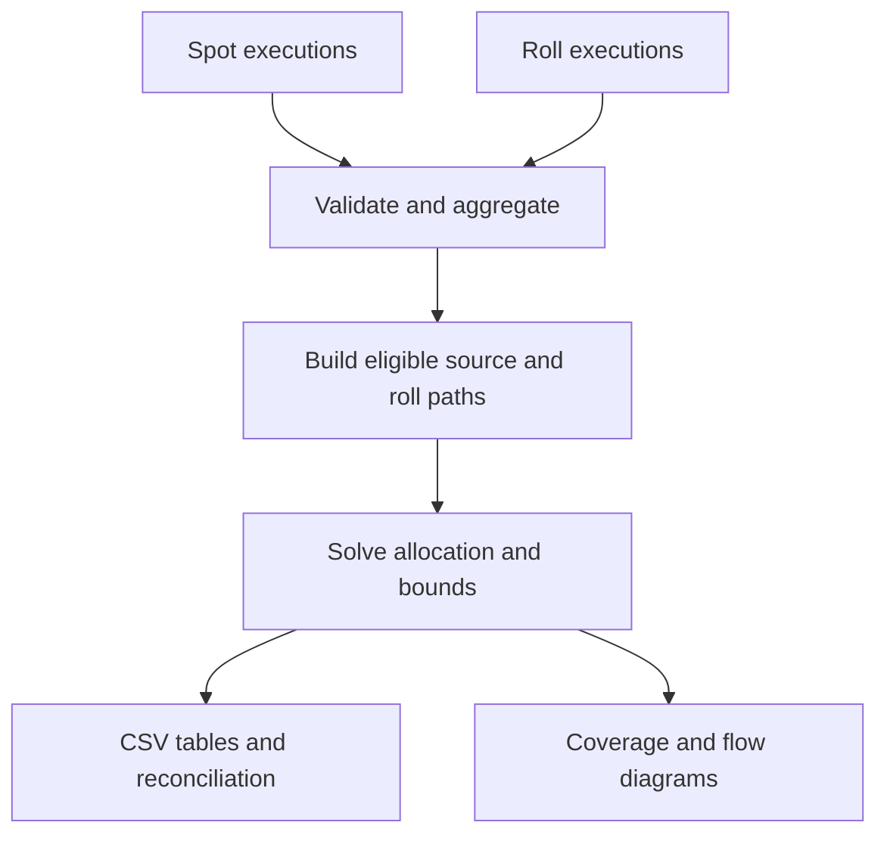

# FX Spot-to-Roll Matching

## Technical specification and operating guide

**Implementation:** `fx_matching_python_v3.zip` / `fx_matcher.py`  
**Document version:** 1.1 (typeset mathematical formulation)  
**Date:** 20 October 2026

**Basis:** v3 Python source, generated sample outputs and the nine-test suite. No external market data or proprietary customer data is required.

### Purpose

Link observed FX spot positions to compatible roll transactions when economic orders are split into multiple execution tickets. The system supports partial attribution, competing roll candidates, multiple source groups and consecutive rolls. It preserves `roll_trade_id`, uses `client_id` as the sole customer boundary, and infers position direction from signed amounts.

The output is a feasible allocation of principal, accompanied by uncertainty ranges. It is not proof of economic provenance. The current implementation has no calibrated probability or evidence-scoring model. Its selected allocation follows an explicit illustrative coverage policy.

### What the matcher actually reads

| File | Role | Read by matcher? |
| --- | --- | --- |
| `data/spot_trades.csv` | Raw spot executions | Yes |
| `data/roll_trades.csv` | Raw roll executions | Yes |
| `data/ground_truth.csv` | Known simulated origins, for evaluation only | No |
| `results/roll_aggregation.csv` | Aggregated roll groups generated during the run | No: it is an output |

### Current demonstration

The supplied sparse fixture contains 200 spot tickets and 60 roll tickets, aggregated into 30 roll trade groups. Ten spot tickets, or 5%, belong to position groups with eligible roll candidates. Only two roll groups have such candidates. The remaining 190 spot tickets have no eligible path.

Five percent is an eligibility count at ticket-pool level. It is neither the percentage of notional rolled nor evidence that each eligible ticket was actually rolled.

### Reading guide

Sections 1-3 define inputs and aggregation. Sections 4-7 specify the network, optimisation and uncertainty. Sections 8-10 describe every output. Sections 11-13 cover examples, execution, validation and practical limits.

<!-- pagebreak -->

## 1. Amount conventions and position boundaries

Each `client_id` represents one position pool. `account_id` is not required or used. Currency pairs and position signs define separate pools within each client.

Amounts are signed principal in the currency pair's first currency. For EURUSD, the base currency is EUR; for GBPUSD it is GBP; for USDJPY it is USD.

| Record | Positive amount | Negative amount |
| --- | --- | --- |
| Spot | Client bought base currency: LONG | Client sold base currency: SHORT |
| Roll | Near SELL, far BUY: extends LONG | Near BUY, far SELL: extends SHORT |

**A roll's sign refers to the carried far-leg position.** If a source system signs the near leg, reverse that sign before using the matcher. Both legs are assumed to have equal base-currency principal.

For example, a EURUSD roll with `base_amount=5000000` sells EUR 5m on the near date and buys EUR 5m on the far date. It can extend a positive EURUSD spot position. A negative GBPUSD roll can extend a negative GBPUSD spot position.

No CSV direction column is needed. The optimiser derives an internal BUY/SELL label from the sign, then works with positive magnitudes scaled to millions. Output amounts restore the original sign and base-currency units. Plot quantities are in millions.

### Normalisation requirements

- Use consistent client identifiers. The script checks for blank client IDs but does not resolve aliases or trim all identifiers automatically.
- Use a canonical pair orientation across both inputs. The loader uppercases pair names and removes slashes and spaces.
- Do not simply relabel USDEUR as EURUSD. Correct inversion also requires converting principal with the appropriate rate and reversing economic direction.
- Pair validation checks six alphabetic characters. It does not validate an ISO currency catalogue.
- Resolve duplicates, cancellations, amendments and transaction status upstream. The script rejects duplicate row IDs but does not implement a lifecycle ledger.
- LONG and SHORT groups are not netted. Different clients and different pairs never share capacity.

### Input validation

The loader requires nonzero finite principal, parseable settlement dates, timezone-aware execution timestamps with UTC offset zero, nonblank row IDs and nonblank roll trade IDs. Execution date must not be later than the spot settlement date or roll near date. Every roll must have `start_date < end_date`.

Mixed reversed pair orientations are rejected. Business-day calendars, currency holidays, settlement cutoffs and complete client identity resolution are not validated.

<!-- pagebreak -->

## 2. Input files and schemas

### 2.1 Spot executions: `spot_trades.csv`

| Field | Type | Definition |
| --- | --- | --- |
| `spot_id` | Text | Unique spot execution-ticket ID within the file |
| `client_id` | Text | Customer position boundary |
| `pair` | Text | Canonical six-letter currency pair |
| `trade_time_utc` | UTC timestamp | Execution time, preferably ISO 8601 with Z |
| `value_date` | Date | Spot settlement date, YYYY-MM-DD |
| `base_amount` | Signed number | Base-currency principal; positive LONG, negative SHORT |

```csv
spot_id,client_id,pair,trade_time_utc,value_date,base_amount
S0001,C001,EURUSD,2026-10-01T09:00:01Z,2026-10-05,4000000
S0006,C002,GBPUSD,2026-10-01T09:00:06Z,2026-10-06,-2000000
```

### 2.2 Roll executions: `roll_trades.csv`

| Field | Type | Definition |
| --- | --- | --- |
| `roll_id` | Text | Unique execution-ticket ID within the file |
| `client_id` | Text | Customer position boundary |
| `pair` | Text | Same pair convention as spot input |
| `trade_time_utc` | UTC timestamp | Roll execution time |
| `start_date` | Date | Near-leg settlement date |
| `end_date` | Date | Far-leg settlement date |
| `base_amount` | Signed number | Principal signed by the FAR-leg position |
| `roll_trade_id` | Text | Business roll-trade ID; shared by split tickets |

```csv
roll_id,client_id,pair,trade_time_utc,start_date,end_date,base_amount,roll_trade_id
R0001,C001,EURUSD,2026-10-02T10:01:00Z,2026-10-05,2026-10-12,3000000,RT001
```

### 2.3 Execution IDs and parent trade IDs

`roll_id` identifies one raw row. `roll_trade_id` identifies the business roll order or trade to which one or more executions belong. Different roll trade IDs must remain separate even when customer, pair, dates and amounts coincide.

If no genuine parent ID is available, use a unique identifier per execution. Do not infer a common parent solely from similar fields. The code does not require a parent ID to be globally unique across clients, dates or directions: those remain part of its grouping key.

### 2.4 Ground truth is not an input

The demonstration's `ground_truth.csv` contains `roll_id`, `roll_trade_id`, `source_spot_ids`, `spot_origin_amount` and `other_origin_amount`. These are simulated provenance labels for evaluation. Source IDs describe a pool, not exact ticket-to-ticket allocation. The file may be deleted without changing matching results. There is no ground-truth command-line option.

<!-- pagebreak -->

## 3. Aggregation and traceability

### 3.1 Spot groups

Aggregate by:

```text
client_id, pair, sign(base_amount), value_date
```

Sum principal magnitudes within each group. Preserve the list of `spot_id` values and the minimum and maximum execution timestamps. Because opposite signs are separate, the signed group principal equals the sum of its signed execution amounts.

The five C001 EURUSD spot executions S0001-S0005 each have principal +4m and settle on 5 October. They form a +20m source position. Splitting the economic order into five tickets does not create five independent sources for the roll optimisation.

### 3.2 Roll groups

Aggregate by:

```text
client_id, pair, sign(base_amount),
start_date, end_date, roll_trade_id
```

The two +3m executions belonging to RT001 form a +6m roll group. A separate parent trade on the same dates retains its own group and capacity.

The script writes this representation to `roll_aggregation.csv`, with an identical compatibility copy named `roll_groups.csv`. It is generated from raw roll executions, not loaded as a third matching input.

### 3.3 Group identifiers

Spot groups receive generated IDs such as P001. Roll groups receive IDs such as RG001. They are implementation labels, not economic identifiers. Regenerating groups after changing the input universe can change these IDs. Retain original ticket IDs and `roll_trade_id` for audit and external joins.

### 3.4 Execution-time aggregation

Every group retains `execution_min` and `execution_max`. The graph permits a transition only when the predecessor's latest execution is no later than the successor's earliest execution.

This conservative rule prevents allocation through an execution sequence that is clearly impossible under the assumed policy. However, groups with overlapping execution windows may contain some valid ticket-level transitions that this aggregation excludes. If those cases matter, partition groups into execution batches before solving.

The current script does not automatically create such batches. Pre-hedging and backdated booking practices require an explicit alternative chronology policy.

<!-- pagebreak -->

## 4. Candidate network and processing flow

The implementation partitions optimisation by:

```text
client_id, pair, sign(base_amount)
```

`value_date` and `roll_trade_id` identify sources, nodes and transitions within a partition. They are not independent optimisation boundaries. Partitioning by either would break consecutive rolls or allow separate problems to reuse the same source principal.

### 4.1 Eligible transitions

| Transition | Settlement condition | Execution condition |
| --- | --- | --- |
| Spot source g to roll e | source value date = e near date | source latest execution <= e earliest execution |
| Roll p to roll e | p far date = e near date | p latest execution <= e earliest execution |
| Any reachable state to EXIT | Always permitted | Not applicable |

Client, pair and sign already agree because both states belong to the same partition. Roll far dates strictly exceed near dates, so settlement paths move forward and cannot cycle.

### 4.2 Actual graph representation

The optimiser uses a source-labelled roll-transition graph. For each source, it starts at a source node and performs a queue-based reachability search using an index of rolls by near date. It creates transfer variables only on reachable eligible transitions, then adds an EXIT variable at the source and every reachable roll state.

Separate source labels preserve provenance at group level, while shared roll-capacity constraints prevent different sources from overusing one roll.



### 4.3 Why unrelated rolls can remain

A roll can have unused capacity, and a source can exit without being rolled. There is no constraint requiring every observed roll to come from the observed spot data. Incompatible rolls have no source path and receive zero attribution. Compatible rolls can still be economically unrelated; their ambiguity must be preserved.

<!-- pagebreak -->

## 5. Linear-programming formulation

The following formulation matches the transfer-state representation in `FlowModel`. All optimisation amounts are nonnegative magnitudes in millions of base currency. Sign is restored during export.

### 5.1 Definitions

| Symbol | Meaning |
| --- | --- |
| g | One aggregated spot source |
| e, p | A roll group, identified separately from its execution tickets |
| 0_g | Initial state of source g |
| B_g | Initial magnitude of source g |
| Q_e | Observed roll principal magnitude: shared capacity |
| f(g,p,e) | Principal transferred from predecessor p into roll e |
| u(g,p) | Principal leaving tracking at source or roll state p |
| x(g,e) | Total principal of source g entering roll e |

Only eligible, reachable transfer variables exist. A predecessor can be the source state or another roll state. Let G be the set of spot sources, E the set of roll groups, and E_g the rolls reachable from source g. I_g(e) and O_g(p) are the eligible predecessor and successor sets. Empty sums equal zero. In the formulas these sets are written with calligraphic letters. Let F denote the feasible set defined by equations (1)-(5), including the definition of attributed principal.

### 5.2 Solver and sparse matrices

`FlowModel` constructs sparse conservation and capacity matrices and solves continuous linear programmes with `scipy.optimize.linprog(method='highs')`. Whole-ticket or all-or-nothing restrictions are not imposed. This source-labelled LP supports source-specific restrictions; it should not be assumed to reduce to an ordinary single-commodity min-cost-flow problem in every extension.

<!-- pagebreak -->

## 5. Linear-programming formulation (continued)

### 5.3 Constraints

Source conservation:

$$
\sum_{e\in\mathcal{O}_g(0_g)} f_{g,0_g,e}+u_{g,0_g}=B_g,
\qquad \forall g\in\mathcal{G}.
$$

Roll-state conservation, separately for each source:

$$
x_{g,e}=\sum_{p\in\mathcal{I}_g(e)}f_{g,p,e},
\qquad \forall g\in\mathcal{G},\ e\in\mathcal{E}_g.
$$

$$
x_{g,e}=\sum_{j\in\mathcal{O}_g(e)}f_{g,e,j}+u_{g,e},
\qquad \forall g\in\mathcal{G},\ e\in\mathcal{E}_g.
$$

Shared observed roll capacity:

$$
\sum_{g:\,e\in\mathcal{E}_g}x_{g,e}\leq Q_e,
\qquad \forall e\in\mathcal{E}.
$$

Nonnegativity:

$$
f_{g,p,e}\geq0,\qquad u_{g,p}\geq0
\qquad\text{for every admissible variable.}
$$

Every unit entering a roll must either continue or exit. Capacity applies to the sum of all sources entering that roll. One source amount cannot simultaneously fund competing branches, but it can legitimately appear on successive rolls over time.

<!-- pagebreak -->

## 6. Policy used to select one allocation

Constraints alone normally admit many solutions, including no attribution. The implementation selects one feasible solution with two lexicographic stages.

### 6.1 Stage 1: maximise initial coverage

Minimise principal that exits before its first roll:

$$
E^*=\min_{(f,u,x)\in\mathcal{F}}E(f,u),
\qquad E(f,u):=\sum_{g\in\mathcal{G}}u_{g,0_g}.
$$

Let the optimum be E*. Equivalently, this maximises unique source principal entering at least one roll. It does not maximise total principal summed across repeated rolls.

### 6.2 Stage 2: prefer later terminal dates

Fix Stage 1's objective at its optimum, E = E*. Let days(g,p) be the elapsed calendar days from source g's settlement date to roll p's far date. Source exits have zero elapsed days.

$$
\Delta_{g,e}:=\bigl(t_e^{\mathrm{far}}-d_g\bigr)_{\mathrm{days}},
\qquad
D(f,u):=\sum_{g\in\mathcal{G}}\sum_{e\in\mathcal{E}_g}\Delta_{g,e}\,u_{g,e}.
$$

$$
D^*=\max_{\substack{(f,u,x)\in\mathcal{F}\\E(f,u)=E^*}}D(f,u).
$$

The code minimises -D. The objective is based on where principal finally exits, not directly on how many roll hops it traverses. Two chains with the same terminal date receive the same terminal reward for the same amount.

### 6.3 Interpretation

This policy produces a useful illustrative allocation, but it is not calibrated evidence that the allocation is true. Maximising coverage can attribute an unrelated but compatible roll. Preferring a later terminal date can favour an economically incorrect path. No hit probability or statistical confidence is estimated.

Use the selected amounts together with feasible ranges and external evidence. A narrow range under this policy means the policy strongly constrains the solution; it does not verify provenance.

### 6.4 Adding evidence later

`FlowModel.solve(c)` accepts a linear cost coefficient for every transfer and exit variable. Validated reference fields or a calibrated matching model could provide costs. That extension requires joint calibration of attribution costs and exit costs, followed by recomputation of uncertainty ranges under the same objective.

There is no supplied CLI switch for evidence scores. The shipped script always uses the two-stage illustrative policy. Avoid claiming that this extension is already implemented as a trained production model.

<!-- pagebreak -->

## 7. Allocation ranges and signed results

For every reachable source-roll relationship, the script solves four additional LPs: two for the unrestricted feasible interval and two for the policy-optimal interval.

### 7.1 Full feasible range

$$
L_{g,e}=\min_{(f,u,x)\in\mathcal{F}}x_{g,e},
\qquad
U_{g,e}=\max_{(f,u,x)\in\mathcal{F}}x_{g,e}.
$$

Since source principal may exit immediately, lower bounds generally equal zero. A positive upper bound shows that an attribution is possible, not that it occurred. Bounds for different relationships are calculated separately and need not be attainable simultaneously.

### 7.2 Policy-optimal range

Repeat the minimisation and maximisation of x(g,e), adding:

$$
\mathcal{F}_{\varepsilon}^{*}:=
\left\{(f,u,x)\in\mathcal{F}:\ E(f,u)=E^*,\ D(f,u)\geq D^*-\varepsilon\right\}.
$$

$$
L^{\mathrm{pol}}_{g,e}=\min_{(f,u,x)\in\mathcal{F}_{\varepsilon}^{*}}x_{g,e},
\qquad
U^{\mathrm{pol}}_{g,e}=\max_{(f,u,x)\in\mathcal{F}_{\varepsilon}^{*}}x_{g,e}.
$$

Here epsilon equals `TOL = 1e-7` in the internal terminal-objective units of million base-currency-unit days. Thus the range admits solutions with the same optimal initial coverage and effectively the same terminal objective.

The selected point is one such solution. Ties may be resolved differently across solver versions.

<!-- pagebreak -->

## 7. Allocation ranges and signed results (continued)

### 7.3 Signed export

Let sigma_g be +1 for a LONG source and -1 for a SHORT source. If the optimiser selects a magnitude x-hat, its exported signed amount is:

$$
a_{g,e}=10^6\sigma_g\widehat{x}_{g,e},
\qquad \sigma_g\in\{-1,+1\}.
$$

The exported feasible bounds are sorted numerically:

$$
\bigl[\ell_{g,e},h_{g,e}\bigr]
=10^6\left[\min\{\sigma_g L_{g,e},\sigma_g U_{g,e}\},
\max\{\sigma_g L_{g,e},\sigma_g U_{g,e}\}\right].
$$

Apply the same transformation to policy-optimal bounds.

For example, a magnitude interval [0, 4] for a GBP short becomes the signed interval [-4,000,000, 0]. A selected short roll amount is negative. Residuals also retain that sign.

### 7.4 Flags and numerical tolerances

- `ambiguity=YES` if the unrestricted magnitude interval width exceeds `TOL` internally, approximately 0.1 base-currency units.
- `policy_ambiguity=YES` if its policy interval width exceeds `10*TOL`, approximately 1 base-currency unit.
- Amounts and bounds are rounded to six decimal places on export. This is numerical formatting, not a currency cash-settlement precision rule.

The run checks internal nonnegativity, conservation and roll capacity with numerical tolerances. Tiny negative zero representations or narrow numerical intervals do not indicate an economic change. The validation uses Python assertions, so do not run with `python -O` when relying on those checks.

<!-- pagebreak -->

## 8. Output data dictionary: attribution and network

### 8.1 `allocations.csv`

One row per reachable source group / roll group pair, including candidates with selected amount zero. Rows describe potential attribution, not only confirmed matches.

| Field | Definition |
| --- | --- |
| `client_id` | Client position boundary |
| `pair` | Currency pair; determines principal currency |
| `value_date` | ORIGINAL spot source settlement date |
| `roll_trade_id` | Business ID of the destination roll |
| `source_group_id` | Generated source label, such as P001 |
| `roll_group_id` | Generated roll label, such as RG001 |
| `roll_start_date` | Current destination roll near date |
| `roll_end_date` | Current destination roll far date |
| `allocated_amount` | Selected signed source-to-roll attribution |
| `lower_bound`, `upper_bound` | Full feasible signed interval |
| `policy_lower`, `policy_upper` | Policy-optimal signed interval |
| `ambiguity` | Full interval width exceeds threshold |
| `policy_ambiguity` | Policy interval width exceeds threshold |
| `spot_ids` | Semicolon-separated original source ticket IDs |
| `roll_ids` | Semicolon-separated destination roll ticket IDs |

For a continuation roll, `value_date` still identifies the original source date. It is not changed to the continuation's near date. Use `roll_start_date` for that date.

### 8.2 `matching_network.csv` and `roll_residuals.csv`

These contain identical roll-level reconciliation rows, including rolls that have no candidate source.

| Field | Definition |
| --- | --- |
| `client_id`, `pair` | Client and principal currency context |
| `value_date` | Roll NEAR settlement date |
| `roll_trade_id`, `roll_group_id` | Business trade ID and generated group label |
| `base_amount` | Observed signed roll principal |
| `allocated_amount` | Sum of selected attribution from all sources |
| `unattributed_amount` | Remaining signed roll principal |
| `roll_ids` | Original execution IDs |

The signed reconciliation is `base_amount = allocated_amount + unattributed_amount`, subject to rounding. Unattributed principal has unknown origin. It is not independently proven to be external.

<!-- pagebreak -->

## 9. Output data dictionary: sources, groups and transfers

### 9.1 `source_summary.csv`

One row per aggregated spot source, including sources without any candidate.

| Field | Definition |
| --- | --- |
| `source_group_id` | Generated source identifier |
| `client_id`, `pair` | Client and currency context |
| `value_date` | Source spot settlement date |
| `base_amount` | Initial signed source principal |
| `initially_rolled_amount` | Unique principal entering a first roll |
| `initially_unrolled_amount` | Principal exiting at the initial source state |
| `spot_ids` | Semicolon-separated source ticket IDs |

The two initial amounts reconcile to `base_amount`. Use `initially_rolled_amount` to measure unique initial principal. Summing roll allocations across successive stages counts some principal repeatedly.

### 9.2 `transfers.csv`

Contains selected positive-magnitude transfers or exits above the internal tolerance, exported with the source sign. It records paths rather than merely destination totals.

| Field | Definition |
| --- | --- |
| `client_id`, `pair` | Source client and currency context |
| `value_date` | Original source settlement date |
| `roll_trade_id` | Destination roll business ID; blank for EXIT |
| `source_group_id` | Persistent source label along the path |
| `from_node` | Source group or predecessor roll group |
| `to_node` | Destination roll group or literal EXIT |
| `amount` | Signed amount transferred or exiting |

### 9.3 Group tables

`spot_groups.csv` contains aggregated sources. `roll_aggregation.csv` contains aggregated rolls and is identical to `roll_groups.csv`.

| Field | Definition |
| --- | --- |
| `group_id`, `client_id`, `pair` | Generated label and pool context |
| `value_date` | Spot settlement date, or roll near date |
| `roll_trade_id` | Parent roll ID; blank for spot groups |
| `start_date`, `end_date` | Roll leg dates; both equal settlement date for spots |
| `base_amount` | Signed group principal |
| `trade_ids` | Semicolon-separated original ticket IDs |
| `execution_min`, `execution_max` | Earliest and latest execution times in group |

No direction field is exported. The sign provides it. Use generated IDs to join within one run and original IDs to reconcile externally.

<!-- pagebreak -->

## 10. Output reports and metadata

### 10.1 `match_coverage.json`

| Key | Definition |
| --- | --- |
| `spot_tickets` | Raw spot execution count |
| `eligible_spot_tickets` | Unique raw IDs belonging to sources with reachable rolls |
| `eligible_spot_percent` | Eligible spot IDs / total spot tickets, multiplied by 100 |
| `roll_groups` | Number of aggregated observed roll groups |
| `eligible_roll_groups` | Number of distinct roll groups reachable from any source |

Eligibility is independent of whether the selected allocation is positive on a particular relationship. A source group with any candidate contributes all its original ticket IDs to the count. This does not identify which individual tickets supplied principal.

### 10.2 `run_info.json`

Records `policy`, `raw_spots`, `raw_rolls`, `source_groups`, `roll_groups`, `candidate_source_roll_links`, `chronology`, `amount_convention` and a note about uncertainty. It is a run description, not a complete audit manifest or model version registry.

### 10.3 PNG diagrams

| File | Interpretation |
| --- | --- |
| `match_coverage.png` | Eligible versus no-candidate counts for spot tickets and roll groups |
| `allocation_ranges.png` | Full range in light colour, policy range in teal, selected point in orange |
| `flow_Cxxx.png` | Date-node display of selected roll attribution by client, pair and LONG/SHORT panel |

Flow labels show `roll_trade_id: selected / observed` principal in millions, with signs preserved. Grey edges have zero selected attribution. Exact source-labelled transfers and EXIT amounts are in `transfers.csv`; they are not all drawn on the date-node display.

The plotting code generates network reports for up to ten candidate-bearing clients, selected in sorted client-ID order. These client reports can include other unmatched groups belonging to the same client. `allocation_ranges.png` is generated only when candidate relationships exist. Coverage and tabular outputs are generated even when no candidate exists.

### Output-directory hygiene

The current script overwrites files it regenerates but does not remove stale files from a previous run. Use a new or cleared output directory when changing the input universe, especially when the set of plotted clients or candidate links changes.

<!-- pagebreak -->

## 11. Sparse example and expected interpretation

| Position pool | Initial principal | Eligible parent roll | Selected attribution | Initially unrolled |
| --- | --- | --- | --- | --- |
| C001 EURUSD LONG, 5 Oct | +20m EUR | RT001, 5-12 Oct | +6m EUR | +14m EUR |
| C002 GBPUSD SHORT, 6 Oct | -10m GBP | RT002, 6-13 Oct | -4m GBP | -6m GBP |

The two RT001 tickets are +3m each; the two RT002 tickets are -2m each. These four raw roll tickets form two aggregated rolls. The other 28 roll groups receive no attribution. The fixture's date construction intentionally prevents the other 190 spot tickets from reaching any roll.

For C001, the unrestricted signed allocation range is [0, +6m]. For C002 it is [-4m, 0]. The illustrative coverage policy selects +6m and -4m respectively. Ground truth agrees in this constructed example, but the inputs alone still allow an explanation in which those compatible rolls came from other positions.

### Coverage figure

The companion PDF includes the coverage diagram generated from the supplied v3 run. Its two eligible counts are 10 of 200 spot tickets and 2 of 30 roll groups.

### Consecutive-roll capability

The sparse fixture deliberately has no continuation chain. The implementation supports one whenever a predecessor far date equals a successor near date and execution ordering is permitted. The test suite verifies that a later roll cannot obtain more source principal than reached it through prior rolls.

### Interpretation of an external-looking roll

No-candidate rolls are incompatible with the observed spot sources under the configured rules. This is a statement about the available input window and model, not proof that they have no spot origin anywhere. A missing historical source, missing intermediate roll or a rejected chronology assumption may explain the absence of a path.

<!-- pagebreak -->

## 12. Running, regenerating and checking the implementation

### 12.1 Package layout

```text
fx_matcher.py
generate_sparse_sample.py
test_fx_matcher.py
requirements.txt
README.md
data/spot_trades.csv
data/roll_trades.csv
data/ground_truth.csv
results/...
```

Use Python 3.10 or later. Runtime dependencies are NumPy, SciPy and Matplotlib. Plotting uses the noninteractive Agg backend, so a GUI is not required.

```bash
python -m pip install -r requirements.txt
python fx_matcher.py
```

No arguments are required. Default input and output paths are resolved relative to the script's own directory, not the shell's current directory. The script directory must be writable for default outputs. Custom relative paths are interpreted relative to the shell's working directory.

```bash
python fx_matcher.py --spot my_spots.csv --roll my_rolls.csv --out my_results
```

### 12.2 Regenerate the sparse fixture

```bash
python generate_sparse_sample.py
```

The generator uses random seed 20261020 and overwrites the three bundled data files. It does not rerun matching or refresh result files. Run the matcher afterwards. It does not change dates to today's date; its October 2026 dates are intentional fixed test data.

### 12.3 Tests and failure handling

```bash
python -m unittest -v test_fx_matcher.py
```

Nine tests cover shared roll capacity across two sources, continuation limits, execution ordering, competing branches, sources without rolls, signed input parsing, preservation of distinct roll trade IDs, opposite-sign separation and exact sparse-fixture eligibility.

The loader raises an exception on invalid required data. An unsuccessful solver status raises a runtime error. The script does not silently drop invalid rows or continue after solver failure. Input validation and solver diagnostics should be wrapped with operational logging if deployed as a service.

<!-- pagebreak -->

## 13. Limits, scaling and implementation map

### 13.1 Supported scope

The current implementation supports divisible base-currency principal, multiple spot sources, split roll executions, partial rolls and consecutive rolls. It does not support unequal near/far principal, ticket indivisibility, FX notional conversion, automatic netting, backward rolls or full reconstruction of unobserved positions.

The observation window must include relevant earlier sources and intermediate rolls if they are to be traced. Immediate or later EXIT means tracking stops; it does not prove settlement, a client close-out or a specific economic event.

### 13.2 Performance

The code indexes roll near dates and uses sparse LP constraints. Reachable roll states and transfer variables are replicated by source. Large connected partitions can therefore grow materially even after input aggregation. Four bound solves are performed per candidate relationship, in addition to the two allocation-policy solves per partition with sources.

This is a reference implementation, not a production benchmark. For larger datasets, consider database-side preaggregation, connected-component decomposition, selective bounds for material links and bounded chart generation. Those improvements are recommendations, not features already implemented. The current plots can become crowded when many source groups share dates.

### 13.3 Function map

| Function or class | Responsibility |
| --- | --- |
| `load_csv` | Load, normalise basic fields and validate required input |
| `aggregate` | Build signed-direction groups while preserving original IDs |
| `partition_key` | Independent client / pair / sign boundary |
| `FlowModel.__init__` | Reachability, transfer graph and sparse matrices |
| `FlowModel.solve` | Continuous LP solve with optional extra constraints |
| `FlowModel.representative` | Two-stage illustrative allocation policy |
| `FlowModel.bounds` | Full feasible or policy-optimal allocation range |
| `FlowModel.validate` | Numerical flow and capacity checks |
| `external`, `write_csv` | Prepare group records and write CSVs |
| `plot_network`, `plot_ranges` | Client flow and uncertainty graphics |
| `run` | Orchestrate loading, matching, outputs and coverage reporting |

### 13.4 Practical review checklist

- Confirm the base-currency and FAR-leg roll sign convention before use.
- Verify client identity and whether client-level pooling is appropriate.
- Confirm chronology rules, including any pre-hedging practice.
- Reconcile signed source amounts and roll capacities, without summing different currencies.
- Read full feasible intervals alongside selected and policy-optimal amounts.
- Use ground truth only for evaluation, never as matching input.
- Keep unmatched records and unknown-origin residuals visible.
- Retain external transaction evidence before describing any inferred allocation as verified.

